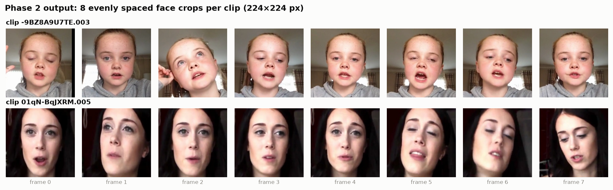
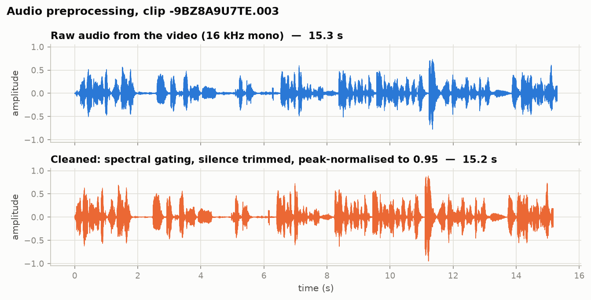
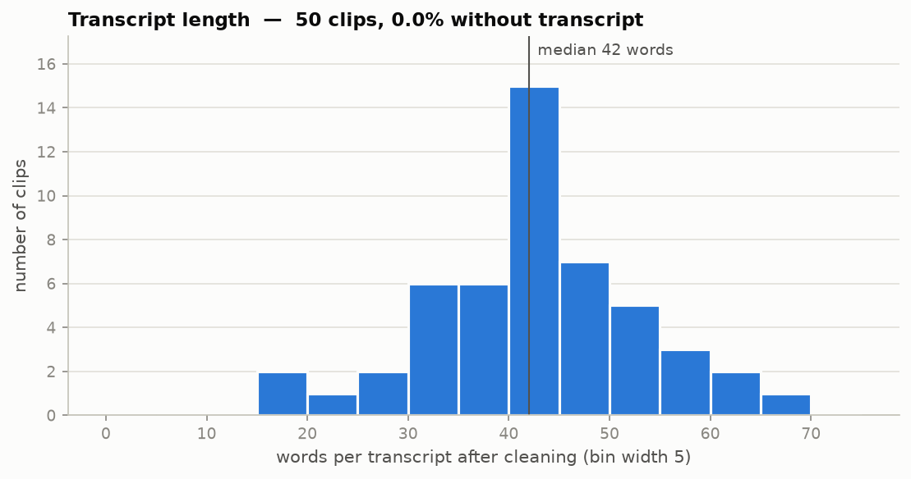

# Phase outputs

What each phase produced: the files it writes and the results of the latest run.
What each phase *does* is described in [README.md](README.md).

> **WARNING — FAKE LABELS.** Every number below comes from the smoke run of 2026-10-13:
> **50 clips, `USE_HEAVY_MODELS=0`, and RANDOM dummy Big Five labels.**
> Anything derived from the labels (medians, positive rates, and later all model metrics) is
> meaningless and must not be reported. Clip counts, frames, audio and text are real.
> This file is updated after every phase and after the full run on real data.

| Phase | Ran on | Acceptance check |
|---|---|---|
| Smoke helper | 56 local video files | — |
| 1. Data preparation | 50 clips, fake labels | Passed |
| 2. Preprocessing | 50 clips | Passed |
| 3–11 | not run yet | — |

---

## Smoke helper — `src/00_make_smoke_data.py`

**Files written**

| File | Content |
|---|---|
| `data/raw/videos/*.mp4` | Clips renamed to their original ChaLearn names |
| `data/raw/video_rename_map.csv` | `downloaded_name, original_name` for every rename (to undo it) |
| `data/raw/transcripts/transcription_hf_subset.pkl` | `{video_filename: text}` — real transcripts for the local clips |
| `data/raw/annotations/DUMMY_FAKE_annotation_RANDOM_SCORES.pkl` | `{trait: {video_filename: score}}` — **random** scores |

**Result of the run**

| | |
|---|---|
| Video files found | 56 |
| Matched and renamed | 54 |
| Duplicates (left untouched) | 2 — `First Impressions V2 (38).mp4`, `First Impressions V2 (41).mp4` |
| Not found on the mirror | 0 |
| Transcripts fetched | 54 of 54 |
| Dummy labels written | 54 clips |

---

## Phase 1 — Data preparation — `src/01_prepare_data.py`

**Files written**

| File | Content |
|---|---|
| `data/splits.csv` | One row per clip |
| `data/FAKE_LABELS_DO_NOT_REPORT.txt` | Exists only while the dummy labels are in use |
| `data/raw/zips/.extracted.txt` | Names of zips already unpacked (written when zips are present) |

Columns of `data/splits.csv`:
`video_id, youtube_id, split, text, openness, conscientiousness, extraversion, agreeableness, neuroticism, openness_bin, conscientiousness_bin, extraversion_bin, agreeableness_bin, neuroticism_bin`

**Result of the run**

| | |
|---|---|
| Label file used | `DUMMY_FAKE_annotation_RANDOM_SCORES.pkl` (**fake**) |
| Transcript file used | `transcription_hf_subset.pkl` |
| Videos on disk / with labels | 56 / 54 |
| Clips kept (`MAX_CLIPS=50`) | 50 |
| Unique `youtube_id`s | 29 |
| Clips without transcript | 0 |

| Split | Clips | YouTube IDs | Share of clips |
|---|---|---|---|
| train | 31 | 20 | 62.0% |
| val | 7 | 4 | 14.0% |
| test | 12 | 5 | 24.0% |

- Train positive rate: 51.6% for every trait (**from fake labels**).
- The ratio is off 70/15/15 because 29 YouTube IDs are too few to split evenly; the
  out-of-range warning is only raised on real data.
- With 7 validation clips, extraversion has no positive example in val (**fake labels**).
  Later phases report the affected metrics as NaN.

**Acceptance check: passed** — no `youtube_id` in more than one split, every trait 45–55%
positive in train, no NaN in trait columns.

---

## Phase 2 — Preprocessing — `src/02_preprocess.py`

**Files written**

| File | Content |
|---|---|
| `data/processed/frames/<video_id>_<k>.jpg` | Frame `k` (0–7), face-cropped, 224×224 |
| `data/processed/audio/<video_id>.wav` | Cleaned audio, 16 kHz mono, 16-bit |
| `data/splits.csv` | Updated: columns `text_clean` and `missing_text` added, failed clips removed (now 16 columns) |
| `data/processed/preprocess_log.csv` | Per clip: `faces_found` (0–8), `raw_sec`, `clean_sec` |
| `data/processed/failed_clips.csv` | `video_id, reason` for dropped clips |
| `results/sample_frames.png` | 8 face crops of 2 sample clips |
| `results/sample_waveform.png` | Raw vs cleaned audio of one clip |
| `results/text_length_hist.png` | Words per cleaned transcript |

**Result of the run**

| | |
|---|---|
| Clips in `splits.csv` | 50 |
| Clips failed / dropped | 0 |
| Frames | 400 jpg (8 per clip) |
| Audio | 50 wav |
| Transcripts present / missing | 50 / 0 (0.0% missing) |
| Faces detected | 383 of 400 frames (95.8%); centre crop used for the other 17 |
| Clips with no face in any frame | 0 |
| Mean audio length | 15.1 s raw → 15.0 s after trimming silence |
| Words per cleaned transcript | median 42, range 16–67 |
| Run time | about 40 s for 50 clips |

The folders also hold frames and audio for 4 spare clips (432 jpg, 54 wav on disk) from the
resume test. They are not in `splits.csv`, so no later phase uses them.

**Resume test**

| Situation | Clips processed |
|---|---|
| Re-run, nothing changed | 0 of 50 |
| `splits.csv` grown from 50 to 54 clips | 4 (only the new ones) |

**Acceptance check: passed** — every clip in `splits.csv` has 8 frames and 1 wav.

**Figures**

---

## Phases 3–11 — not run yet

Expected outputs, from the roadmap:

| Phase | Expected output files |
|---|---|
| 3 | `features/visual_cnn.npy`, `visual_emotion.npy`, `visual_vit.npy` |
| 4 | `features/audio_mfcc.npy`, `audio_mfcc_cols.json`, `audio_w2v.npy`, `audio_emotion.npy` |
| 5 | `features/text_tfidf.npy`, `tfidf_vocab.json`, `text_minilm.npy`, `text_emotion.npy`, `ids.csv` |
| 6 | `results/unimodal.csv`, `results/unimodal_f1.png`, `results/models/` |
| 7 | `results/fusion.csv`, `results/unimodal_vs_fusion.png`, `results/intermediate_loss.png` |
| 8 | `results/ablation.csv`, `results/ablation.png` |
| 9 | `results/emotion_trait_corr.png`, `results/confusion_best.png`, `results/summary.md` |
| 10 | `app/streamlit_app.py` |
| 11 | final `README.md`, `run_all.sh` |
